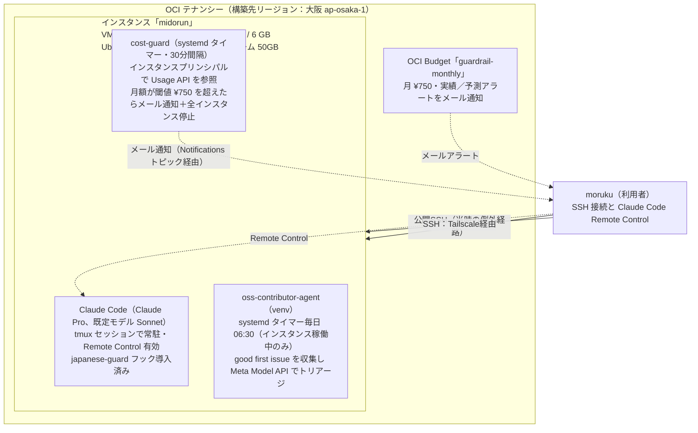

# minorun-oci-cloud-dev-environment

[English](README.md) | 日本語

## 最新計画：OCIと同等の開発環境をMac miniにも作る

**[実施計画はこちら](docs/11-mac-mini-dev-environment-plan.ja.md)**。東京・大阪のA1容量不足に左右されずに開発を続けるため、ホームラボのMac mini上に専用Ubuntu ARM64 VMを作り、tmux＋systemd＋Claude Code＋Remote Controlの開発体験を再現する。受入れが済むまではOCIを残す。

**2026-11-08の状態：計画作成済み・構築未着手。** 読み取り確認でM4／16 GB／空き約142 GiBを確認した。既存サービスの資源割当や経路には未確認項目がある。構成差分、セキュリティ、ネットワーク、資源枠、検証、ロールバックを計画にまとめた。Mac・クラウドの設定変更はしていない。

## これまでの記録（新しい順）

過去の作業日はJSTで整理。11/8の実機確認は計画書内にUTCで記録した。記録済みの構成と、今日の実機再確認は区別する。

| 日付 | 行ったこと・到達点 | 詳細 |
|---|---|---|
| **2026-11-08** | Mac mini向けの同等環境を計画。確認済み仕様と未確認の稼働状態を分け、READMEの入口と資材索引を整理。**構築は未実施** | [Mac mini実施計画](docs/11-mac-mini-dev-environment-plan.ja.md) |
| 2026-11-07 | OCIからユーザーsystemd、Claude設定、日本語フックを回収。資格情報・実行時データは除外。cost-guard資材は未回収 | [回収記録](instance-assets/README.ja.md)、[commit](https://github.com/moruku36/midorun-oci-cloud-dev-environment/commit/f2ac8fca0a5baa5d1267ed5e8a1e9f93b87b38c6) |
| 2026-11-03 | 当時のOCI構成図・READMEと構築資材の索引を整理 | [commit](https://github.com/moruku36/midorun-oci-cloud-dev-environment/commit/c7f4bd55a04e208e3165c69cff212f4158211b89)、[資材索引](scripts/README.md) |
| 2026-11-02 | 円／ドルの閾値を750円に修正。容量不足で1 OCPU／6 GBへ縮小し、必要時起動へ変更。SSHの経路差を記録 | [09](docs/09-oci-cloud-dev-environment.ja.md)、[10 No.13〜15](docs/10-oci-pitfalls.ja.md) |
| 2026-11-01 | 東京の容量不足から大阪へ切替え、OCI Phase 0〜4（Ubuntu ARM64、tmux／systemd、Tailscale、Claude Code Remote Control）を構築。実作業移行は残項目 | [構築記録](docs/09-oci-cloud-dev-environment.ja.md) |
| 2026-11-01 | みのるんの公開資料調査とOCIの当初設計を追加 | [下記01〜08](#ドキュメント)、[情報源](docs/sources.ja.md) |

みのるんの Claude Code 活用法を本人の公開資料から学び、OCI（Oracle Cloud Infrastructure）の Always Free 枠で無料のクラウド開発環境を構築する実践リポジトリ。

## 目的

目的は3つある。正確には2.5個で、3つ目は2つ目の動機に当たる。

1. **学ぶこと**：みのるん（minorun365／御田 稔さん）の Claude Code 活用法を、本人の公開資料（GitHub リポジトリ、Speaker Deck の登壇スライド、著書、Qiita・note 記事）から学ぶ。
2. **実践すること**：そのやり方を実践する場として、OCI の Always Free 枠で無料のクラウド開発環境を構築する。
3. **2つ目の動機**：ローカルの Windows 環境に依存しない開発の場を持つこと。作業中の内容が Windows Update の再起動でリセットされるといった環境固有の問題を避けるため、もう1つの開発環境をクラウドに置く。

「日本で Claude（Code）の使い方が一番うまい人」と言われる彼のやり方を、設定ファイルの実物レベルまで読み解いて整理した。実践編では、彼の EC2 常駐構成（月 $52〜55）を OCI の無料枠に置き換え、systemd＋tmux のセッション保持、Tailscale 接続、Claude Code＋Remote Control までを ¥0 で組む設計を置く（docs/09）。

> 本リポジトリは公開資料の**要約とリンク集**であり、スライドや設定ファイルの転載ではない。実物は必ず各リンク先の原文を参照すること。

## みのるんとは（要点）

- 御田 稔（おんだ みのる）。KDDIアジャイル開発センター（KAG）テックエバンジェリスト／KDDI シニアエキスパート
- **AWS AI Hero**（2025、日本初）、AWS Community Hero（2024）、Qiita 年間 Top Contributor 2024・2025
- 著書7冊。Claude Code の単著『［みのるん式］ビジネスパーソンのためのClaude Code仕事術』（技術評論社、2026-09-24）
- 仕事用 PC 1台で直近3か月に Claude セッション800本超・やり取り約3,500回という運用量

## OCIに構築した環境の記録（2026-11-03 時点）

みのるんの EC2 常駐構成を OCI で再現し、実際に構築した当時の構成である。2026-11-08にはOCI実機の現況を再確認していない。設計と実績の詳細は [docs/09](docs/09-oci-cloud-dev-environment.ja.md)、構築で詰まった所は [docs/10](docs/10-oci-pitfalls.ja.md) にある。2026-11-01 の構築当初から、シェイプの縮小（4 OCPU／24GB → 1 OCPU／6GB）と通貨単位の修正（予算・閾値 USD 5 → ¥750）に伴い変更されている。

| 項目 | 構成 |
|---|---|
| リージョン | 構築先は大阪（ap-osaka-1）。ホームリージョンは東京（ap-tokyo-1） |
| インスタンス | 「midorun」：VM.Standard.A1.Flex（ARM）、1 OCPU／6GB、ブートボリューム 50GB（2026-11-02 にホスト容量不足のため 4 OCPU／24GB から縮小。docs/10 No.14） |
| OS | Ubuntu 24.04 Minimal（Arm、aarch64） |
| 常駐の仕組み | 回収済みユーザーユニット＋linger は tmux セッション「claude」を生成する。Claude 自体の起動・異常終了時の復帰は別確認（Mac計画参照）。当時のCLIは公式Claude ProログインとRemote Controlを利用 |
| 日本語ガード | japanese-guard フック（みのるんの OSS）を、ソースを精査した上で導入（英語応答を機械的に差し戻す） |
| 既定モデル | Claude Code の既定モデルは Sonnet（オーナー指示で設定） |
| アクセス | SSH（ユーザー ubuntu、鍵認証のみ・パスワード認証は無効）の2経路：公開SSH（当時の例外経路）／Tailscale。あわせて Claude Code の Remote Control |
| 課金ガードレール | 二重化している。①OCI Budget「guardrail-monthly」（月 ¥750、実績と予測のアラートをメール通知）②箱側の自動停止 cost-guard（systemd タイマー30分間隔、インスタンスプリンシパルで Usage API を読み、月額が閾値 ¥750 を超えたらメール通知＋稼働中インスタンスを全停止） |
| その他の常駐ジョブ | oss-contributor-agent の収集ジョブ（venv、systemd タイマー毎日 06:30、インスタンス稼働中のみ動作）。対象リポジトリの good first issue を収集し、Meta Model API でトリアージする |
| 運用方針 | 記録上は必要時に起動し、終了後に停止する方針。11/7に資材回収の記録あり。11/8の電源状態は未確認 |

## 構築資材（scripts/）

入口は[資材索引](scripts/README.md)。回収済みのユーザーsystemdとClaude設定は [instance-assets/](instance-assets/README.ja.md) にあり、cost-guard本体・設定等は未回収。資格情報と実行時データは収録しない。別環境への再構築では、[Mac mini計画](docs/11-mac-mini-dev-environment-plan.ja.md)の移植差分と復旧の残項目を確認する。

## ドキュメント

| # | ドキュメント | 内容 |
|---|---|---|
| 11 | [Mac miniに同等の開発環境を作る計画](docs/11-mac-mini-dev-environment-plan.ja.md) | Ubuntu ARM64 VM案、確認済み前提、OCIとの差分、構築順、セキュリティ、受入れ、ロールバック。構築未着手 |
| 10 | [OCI 困った集](docs/10-oci-pitfalls.ja.md) | AWS／Azure／GCP 経験者が OCI 初構築で詰まる所を随時追記する生きた記録：テナンシー名サインイン、無料枠の半減、用語対応表、在庫不足ほか |
| 09 | [OCI クラウド開発環境の設計](docs/09-oci-cloud-dev-environment.ja.md) | みのるんの EC2 構成を OCI Always Free で ¥0 再現する設計：A1.Flex の取り方、systemd＋tmux、Tailscale、Claude Code（Pro）＋Remote Control、無料を守る運用ルール |
| 08 | [自分の環境への取り入れ方](docs/08-takeaways.ja.md) | 優先順位つき実践チェックリスト |
| 07 | [記事（Qiita／note ほか）](docs/07-articles.ja.md) | 代表記事の要点 |
| 06 | [スライドと登壇](docs/06-slides-and-talks.ja.md) | Speaker Deck の主要デッキ要約と登壇情報 |
| 05 | [Claude Code on EC2](docs/05-claude-code-on-ec2.ja.md) | EC2 常駐＋スマホ Remote Control の構成とセキュリティ所見 |
| 04 | [japanese-guard](docs/04-japanese-guard.ja.md) | 英語に切り替わった応答を Stop hook で機械的に差し戻す仕組み |
| 03 | [設定ファイルの実物解剖](docs/03-settings.ja.md) | my-claude-code-settings：CLAUDE.md／AGENTS.md の分け方、settings.json、rules／hooks／agents／skills、学習ループ |
| 02 | [中核の考え方](docs/02-philosophy.ja.md) | 半自動化、モノレポと「コンテキストの複利」、プチ仕様駆動開発、音声入力、承認と安全 |
| 01 | [プロフィールと著書](docs/01-profile-and-book.ja.md) | 経歴・受賞、著書の目次と狙い、書評まとめ |
| — | [情報源一覧](docs/sources.ja.md) | 全リンクと確認範囲（実読／スニペットのみ）の明記 |

## 一番の学び（3行）

1. **全自動でなく「半自動化」**：AI に最初から最後まで任せ、人間は要所の承認だけ回す。
2. **仕事場（モノレポ）にコンテキストを貯める**：手順・文面・こだわりが残り、別の仕事の質まで上がる＝「コンテキストの複利」。
3. **ルールは自然言語、止めるべき所だけ hook で機械的に止める**：学習は「学習しといて」の一言で設定へ反映し、夜間バッチは提案まで・反映は人間が採用する。

## 調査について

- 調査日：2026-11-01
- 一次情報（本人の GitHub リポジトリの実ファイル、gihyo.jp 公式ページ、Speaker Deck のトランスクリプト、Qiita／note 本文）を実際に読んで要約した。各ドキュメント末尾と [情報源一覧](docs/sources.ja.md) に、実読できたもの／検索スニペットのみのものを区別してある。

