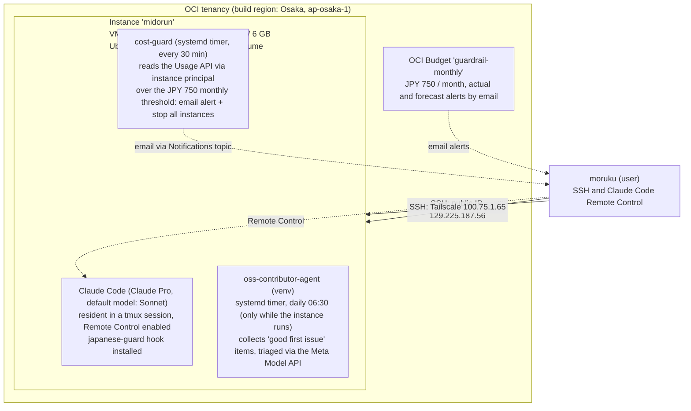

# minorun-oci-cloud-dev-environment

English | [日本語](README.ja.md)

A hands-on repository that studies how Minorun uses Claude Code, and rebuilds his always-on setup as a free cloud development environment on OCI (Oracle Cloud Infrastructure) Always Free in Osaka (ap-osaka-1).

## Purposes

This repository has three purposes — precisely 2.5, because the third is the motive behind the second.

1. **Study** how **Minorun** (minorun365 / Minoru Onda) — widely regarded as one of Japan's most skilled Claude Code practitioners — uses Claude Code, distilled from his own public materials: GitHub repositories, Speaker Deck talks, his book, and Qiita/note articles.
2. **Build**: put that practice to work by building a free cloud development environment on OCI Always Free.
3. **The motive behind the second**: have a development place that does not depend on the local Windows environment — keeping a second development environment in the cloud avoids local-environment-specific problems, such as Windows Update reboots resetting work in progress.

His setup is examined down to the actual configuration files, with an actionable checklist for adopting the ideas in your own development and daily work. The hands-on part (docs/09) re-creates his always-on EC2 setup (about $52–55/month) on OCI's free tier at ¥0: systemd + tmux auto-recovery, Tailscale access, and Claude Code with Remote Control.

> This repository is a **summary and link collection** of public materials, not a reproduction of his slides or config files. Always consult the originals at the linked sources.

## Who is Minorun? (short version)

- Minoru Onda, Tech Evangelist at KDDI Agile Development Center (KAG) / Senior Expert at KDDI
- **AWS AI Hero** (2025, first in Japan), AWS Community Hero (2024), Qiita Top Contributor 2024 & 2025
- Author of 7 books, including the solo-authored *[Minorun-style] Claude Code Work Techniques for Business People* (Gijyutsu-Hyohron, Sep 24, 2026)
- Runs 800+ Claude sessions and ~3,500 interactions per quarter on a single work PC

## Architecture

The environment actually built (as of 2026-11-03). Design details are in [docs/09](docs/09-oci-cloud-dev-environment.md); build pitfalls are logged in [docs/10](docs/10-oci-pitfalls.md).

| Item | Configuration |
|---|---|
| Region | Built in Osaka (ap-osaka-1); home region is Tokyo (ap-tokyo-1) |
| Instance | "midorun": VM.Standard.A1.Flex (ARM), 1 OCPU / 6 GB, 50 GB boot volume (shrunk from 4 OCPU / 24 GB on 2026-11-02 due to host capacity — docs/10 No.14) |
| OS | Ubuntu 24.04 Minimal (Arm) |
| Resident setup | A systemd user unit + linger keeps the tmux session "claude" alive so Claude Code stays resident; Remote Control enabled. Claude Pro sign-in means no API billing. Default model is Sonnet |
| Japanese guard | The japanese-guard hook (Minorun's OSS), adopted after a line-by-line source review |
| Access | SSH (user ubuntu, key authentication only) over two routes — public IP 129.225.187.56 and Tailscale 100.75.1.65 — plus Remote Control |
| Billing guardrails | Two layers: (1) OCI Budget "guardrail-monthly" at JPY 750/month with actual/forecast email alerts; (2) cost-guard (systemd timer, every 30 min) reads the Usage API and, once the month passes the JPY 750 threshold, sends an email alert and stops all instances |
| Other resident jobs | The oss-contributor-agent collector (systemd timer, daily 06:30, only while the instance is running): collects "good first issue" items from target repositories and triages them via the Meta Model API |
| Operating policy | Start the instance only when used, and stop it afterwards. It is currently stopped |

## Build assets

The scripts and configuration used to build this environment are collected under [scripts/](scripts/README.md), so the same environment can be rebuilt — including on another cloud. Environment-specific values (email addresses, OCIDs, and the like) are replaced with placeholders there.

## Documents

| # | Document | Contents |
|---|---|---|
| 01 | [Profile and book](docs/01-profile-and-book.md) | Career, awards, the book's aims and table of contents, review roundup |
| 02 | [Core philosophy](docs/02-philosophy.md) | Semi-automation, the monorepo and "compound interest of context", mini spec-driven development, voice input, approvals and safety |
| 03 | [Anatomy of his settings](docs/03-settings.md) | my-claude-code-settings: the CLAUDE.md / AGENTS.md split, settings.json, rules / hooks / agents / skills, the learning loop |
| 04 | [japanese-guard](docs/04-japanese-guard.md) | A Stop hook that mechanically sends English-drifted replies back for a Japanese rewrite |
| 05 | [Claude Code on EC2](docs/05-claude-code-on-ec2.md) | Always-on Claude Code on EC2 with smartphone Remote Control; architecture and security notes |
| 06 | [Slides and talks](docs/06-slides-and-talks.md) | Summaries of his key Speaker Deck decks and talks |
| 07 | [Articles](docs/07-articles.md) | Key points from his Qiita / note writing |
| 08 | [Adopting it in your own setup](docs/08-takeaways.md) | A prioritized, practical checklist |
| 09 | [OCI cloud development environment design](docs/09-oci-cloud-dev-environment.md) | Rebuilding Minorun's EC2 setup on OCI Always Free at ¥0: getting an A1.Flex instance, systemd + tmux, Tailscale, Claude Code (Pro plan) with Remote Control, and the rules that keep it free |
| 10 | [OCI pitfalls](docs/10-oci-pitfalls.md) | A living log of where an AWS/Azure/GCP user trips on a first OCI build: the tenancy-name sign-in, the halved free tier, a terminology mapping table, capacity shortages, and more as they happen |
| — | [Sources](docs/sources.md) | All links, with what was read in full vs. snippet-only |

## The three biggest lessons

1. **Semi-automation, not full automation**: let the AI run work end to end; the human only steps in at approval points.
2. **Accumulate context in one workplace (a monorepo)**: procedures, phrasing and preferences persist there and raise the quality of unrelated work — the "compound interest of context".
3. **Rules in natural language; hooks only where a machine can decide**: learnings are folded back into settings with a single "remember this", and nightly automation only *proposes* changes — a human adopts them.

## About this research

- Researched on 2026-11-01.
- Primary sources were read directly (the actual files in his GitHub repositories, the official gihyo.jp book page, Speaker Deck transcripts, Qiita/note article bodies) and summarized. Each document and the [source list](docs/sources.md) distinguish what was read in full from what is based on search snippets only.
