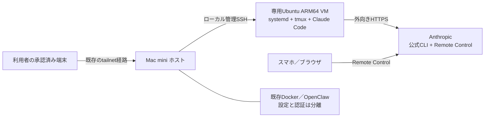

# 11 Mac mini に OCI と同等の開発環境を作る計画

[English](11-mac-mini-dev-environment-plan.md) | 日本語

作成日：2026-11-08。状態：**計画作成済み・構築未着手**。

## 1. 何を作るか

OCI の東京・大阪で起きた A1 容量不足に左右されず、Windows の再起動からも切り離して開発を続けられるよう、ホームラボの Mac mini にもう1つの開発環境を用意する。第一候補は **Mac mini 上の専用 Ubuntu 24.04 ARM64 VM**。その中へ、このリポジトリの tmux、systemd、Claude Code、japanese-guard、Remote Control の構成を移す。

OCI を直ちに廃止・置換せず、並行して小さなリポジトリで受入れを行う。「同等」は開発体験と再現可能な設定を指す。OCI の可用性、IAM、課金ガードや停電耐性まで同じになるわけではない。

**今回行ったことは公開資料の調査、Mac の読み取り確認、計画と索引の更新だけ。** VM 作成、ソフトウェア導入、サービス起動・停止、ログイン、ネットワーク・権限・電源設定の変更は行っていない。構築時は、その時点の所有者の指示と既存の許可を照合し、不足する操作だけ確認する。

## 2. 確認した前提

### OCI 側：実機の現況ではなく記録と回収資材

2026-11-08 に main の [f2ac8fca](https://github.com/moruku36/midorun-oci-cloud-dev-environment/commit/f2ac8fca0a5baa5d1267ed5e8a1e9f93b87b38c6) を確認した。OCI を起動したり、コンソールやインスタンスを再点検したりはしていない。

| 項目 | 記録から確認した内容 | 根拠・注意 |
|---|---|---|
| 計算資源 | 大阪 A1.Flex、1 OCPU／6 GB、ブート50 GB | [09](09-oci-cloud-dev-environment.ja.md)。11/2に4 OCPU／24 GBから縮小 |
| OS／開発ツール | Ubuntu 24.04 Minimal ARM64、tmux、git、Python、Node.js、Claude Code | 09の導入実績。現在のバージョン・更新状態は未再確認 |
| アクセス | Tailscale と公開SSHの例外経路、Claude Code Remote Control | [10 No.12・15](10-oci-pitfalls.ja.md)。経路ごとの確認が必要 |
| 設定回収 | systemd 3ファイル、Claude設定、日本語フック | [11/7回収資材](../instance-assets/README.ja.md)。資格情報・実行時データは含まない |
| 定期ジョブ | OSS Contributor Agent収集、日次06:30のタイマー | 本体は[別repo](https://github.com/moruku36/oss-contributor-agent)。料金・通知・実行状態は移植前に確認 |
| OCIガード | Budget月750円、Usage API＋自動停止 | OCI専用。Macへ移植しない。スクリプト等は未回収 |
| 運用 | 必要時に起動する方針、11/7に資材回収 | 現在の電源状態は未確認。「停止中」を現時点の実測とはしない |

**回収資材を読んで分かった差分：** [claude-session.service](../instance-assets/systemd/claude-session.service) の ExecStart は空の tmux セッションを作るだけで、Claude Code 自体を起動しない。RemainAfterExit=yes のため、tmux／Claude の死活監視や異常終了後の自動復旧も保証しない。最初は手動で Claude を起動し、必要なら別変更で明示的な起動ラッパーと監視・再起動上限を設計する。既存の「常駐」説明だけから自動復旧済みと判断しない。

### Mac mini 側：11/8の読み取り結果と既存資料を分ける

| 項目 | 2026-11-08 UTCに確認したこと | 制約 |
|---|---|---|
| ハードウェア | Apple M4、CPU10コア（P4＋E6）、arm64、メモリ16 GB | system_profiler、unameによる読み取り |
| OS | macOS 27.2（build 26B123） | sw_versによる読み取り。VM製品の対応は構築時に確認 |
| ストレージ | 内蔵APFS容量約228 GiB、空き約142 GiB | dfによる当日の値。構築直前に再取得 |
| 既存ソフト | Docker Desktop、Tailscaleアプリ、docker／kubectlコマンドが存在 | 存在確認であり、稼働や接続成功の証明ではない |
| Dockerディスク | スパースディスクの実割当は約3.6 GB | 見かけの上限を使用量や空き容量と混同しない |

ロック解除は不要で上記を読めた。ただし Docker API、設定、プロセス一覧の読み取りは権限制約で取得できなかった。**コンテナ一覧・稼働状態、CPU／メモリ上限、ネットワーク、VM製品の導入有無、Tailscaleの現在の参加・到達性は未確認**。権限変更や回避はしていない。

ホームラボの公開記録も参照した。

- [11/1キッティング記録](https://github.com/moruku36/home-ai-engineering-lab/blob/main/docs/mac-mini-kitting-record-2026-11.md)：M4／16 GB／256 GB機の導入、SSH・Tailscale接続の当時の実績。FileVault、電源復帰、鍵認証、ファイアウォール等に残項目がある。11/8の現況へ無条件には引き継がない。
- [11/6 OpenClaw記録](https://github.com/moruku36/home-ai-engineering-lab/blob/main/docs/openclaw-status-2026-11-06.ja.md)：Mac上のOpenClaw、Dockerブラウザ、CLIログイン等の限定検証。全体の運用受入れや認証分離は未完了。
- [運用分担](https://github.com/moruku36/home-ai-engineering-lab/blob/main/docs/home-ai-lab-openclaw-operations.ja.md)：構築・変更はDots、運用はOpenClawを段階受入れする設計。今回のVMを自動的に運用対象に加えない。

NUC上の既存サービスと隔離解析ゲストはそのまま残す。新VMは敵対的コードを安全に実行するための受入れ済み隔離環境ではない。

## 3. 方式の比較と第一候補

| 方式 | 利点 | 差分・判断 |
|---|---|---|
| **専用Ubuntu ARM64 VM（第一候補）** | OCIのLinux／systemd／apt／venvを保持できる。ホストの既存CLI設定と分けやすい | VM分のRAM・ディスクが増える。ホスト起動、VM起動、ゲスト常駐を別々に検証する |
| macOSネイティブ | 追加VMのメモリ不要。既存CLIを利用できる可能性 | systemdをlaunchdへ再設計、GNU／BSD差、パス・権限差が生じる。同等性確認の範囲が広い |
| 既存Docker Desktopのコンテナ | 既存ランタイムを活用できる可能性 | 通常のコンテナはsystemd＋lingerの代替ではない。socket・ホストマウント・認証共有のリスク。最初の移植先にはしない |

VM管理は **Lima＋Apple Virtualization.framework（VZ）を候補**とする。Lima公式はmacOS上のネイティブアーキテクチャにVZを案内している（[VM types](https://lima-vm.io/docs/config/vmtype/)）。採用バージョン、macOS対応、Ubuntuイメージの配布元・ハッシュを構築時に固定する。インストール済みとは見なさない。既存VM基盤が見つかれば、併設コストを比較して方式を確定する。方式変更は計画に理由を残す。

### 暫定リソース枠

- 1 VM、ARM64、2 vCPU、RAM **4 GiBから**、仮想ディスク40 GiB上限を開始案とする。OCIの6 GBと同容量ではなく、低負荷の開発受入れ用の暫定値。
- 6 GiBへ増やす場合も、先にDockerと他ワークロードの割当・実負荷を確認する。CPU性能やビルド速度がOCIと同じとは仮定しない。
- 16 GBはmacOS、Docker、OpenClaw、ローカル推論と共有する。最初の受入れでは重い推論や並列ビルドを重ねない。既存サービスを勝手に止めず、競合すれば所有者と時間帯を調整する。
- ホスト空きは50 GiB以上を確保する案とし、VMディスクとバックアップの両方を見積もる。スパース上限、実割当、APFS全体の空きを別に記録する。
- 受入れ時にメモリプレッシャー黄／赤、10分でswapが512 MiB超増加、空き50 GiB未満、既存サービスのエラー増加のいずれかが続けば新VMの試験を止めて見直す。これは暫定停止基準であり性能測定結果ではない。

## 4. 配置とアクセスの設計

最初は既存の承認済みMac到達経路を使い、ホストからVMへローカル管理SSHで入る。Limaの[ネットワーク選択](https://lima-vm.io/docs/config/network/)はlocalhost接続とブリッジ接続を区別している。**新たな公開SSH、ルーターの転送、ブリッジ、サブネットルートは作らない**。自動ポート転送も確認し、承認したloopback宛て以外へアプリが露出しないよう明示設定する。

VMへの直接Tailscale参加は第二段階の選択肢とする。新しい端末登録・ACL・鍵管理・費用条件を別途確認し、必要な操作が許可された場合だけ行う。既存のTailscale認証状態をVMへコピーしない。所有者のWindows、スマホ、構築担当のそれぞれから必要経路を確認する。経路未確立ならその項目を保留し、公開ポート追加で埋め合わせない。

Remote Controlは[公式仕様](https://code.claude.com/docs/en/remote-control)上、外向きHTTPSで動く。一方で会話・ツール実行記録はAnthropic側へ送られるため、「Macで動く＝外部送信なし」ではない。最初は公開リポジトリと合成入力だけで確認する。プラン資格、CLIバージョン、アカウントポリシー、HTTPS到達性も実施時に確認する。

### データ・権限の境界

- 作業リポジトリとvenvはVM内の専用ワークスペースへ置く。ホストホーム全体、既存`.claude`、SSH鍵、Docker socket、ブラウザプロファイルを共有しない。[Limaのマウント](https://lima-vm.io/docs/config/mount/)は既定任せにせず、不要なホストマウントを明示的に無効化し、ゲストから見えないことを検証する。
- 通常の開発は非rootユーザーで行う。必要なsudo、ゲスト管理者とホスト管理者の境界を記録する。ホストとVMは完全なセキュリティ境界だと保証しない。
- 公開文書は構成、受入れ結果、残課題まで。実IP、端末識別子、私的パス、管理URL、生ログ、認証情報は載せない。
- Claude Proは公式CLIへ直接ログインする方針を維持する。OCIやMacホストの資格情報を複製せず、新VMの正規ログインとして別途扱う。OpenClawへトークンを渡さない。APIキーへの自動切替や新規課金をしない。
- OCIのIAM、instance principal、cost-guardの停止権限はVMへ持ち込まない。既存OCIの予算ガードを削除・無効化もしない。Macの電気代・ストレージ消費、Proの共通利用上限は残る。

## 5. 移す資材と変える所

| 資材／機能 | 移植方針 | 合格に必要な確認 |
|---|---|---|
| Ubuntu／CLI | 24.04 ARM64へ必要最小限を導入。現在の公式導入経路・バージョンを固定 | arm64、systemdがPID 1、必要コマンド、代表repoの依存取得とビルド |
| tmux／ユーザーsystemd | 回収ユニットを雛形にし、ユーザー名・作業パス・tmuxの絶対パスを合わせる。lingerは構築時の許可に従う | ログアウト後のセッション維持。VM再起動後は新セッションを作れること |
| Claude／Remote Control | まずtmux内で手動起動。公式CLI、Sonnet、承認設定を個別確認 | CLIプロセスとRemote Controlの実操作まで確認。空tmuxだけで合格にしない |
| japanese-guard | 回収済みのソースを確認して使用。設定の`/home/ubuntu`固定パスを新ユーザーへ置換 | 英語は差し戻し、日本語は通過、設定が他機能を上書きしない |
| OSS日次収集 | **初期移植から除外・既定停止**。必要なら別フェーズで本体repo・認証・費用・通知を確認 | OCIとMacで二重収集・二重通知しない。`--once`の限定試験後に採否判断 |
| 日次タイマー | `OnCalendar=06:30`はゲストtimezone依存、`Persistent=true`は起動時の追い付き実行を起こし得る | 時刻・timezone、停止後起動、同時実行防止を確認。配置だけでenableしない |
| cost-guard | Macへ移植しない。OCI側の現行ガードは維持 | ローカル試験がOCI APIや停止操作を呼ばない |
| 作業中データ | Git追跡ファイルは正規remoteから新規取得。未commit差分・成果物は別途棚卸し | OCI側を消さず、必要データのバックアップ／復元を確認。DB・認証の丸ごとコピー禁止 |

フック試験は回収版の既定閾値に合わせ、最終本文に25字以上の英字があり英字数が日本語文字数の3倍を超える合成文を使う。短い「OK」、コード、URL等の除外と、Stopの再差し戻しを防ぐ条件も確認する。環境変数で閾値を変える場合は試験条件に記録する。

tmuxは接続断に耐えるが、ホストやVMの再起動で実行中プロセスまで復元するものではない。Claudeの会話再開、実行中ジョブの再開、保存済みソースの復旧は別々に検証する。

## 6. 実施順序と停止ゲート

全フェーズは未着手。見積もりは順番を示すもので日付の約束ではない。

| 段階 | 作業 | 次へ進む条件 |
|---|---|---|
| P0 現況・許可の照合 | Docker割当／既存サービス／停止ジョブ／VM基盤／到達経路／バックアップを確認。方式と資源枠を確定 | 未確認事項を解消し、インストール・VM作成・認証・設定変更それぞれの実行範囲が明確 |
| P1 空VM | 公式配布元とハッシュを記録し、専用Ubuntuを作成。ホスト共有・ポート公開を最小化 | OS・資源枠・マウント・経路を確認。既存ラボへ影響なし |
| P2 開発基盤 | git／tmux／Python等とワークスペース、ユーザーsystemd、日本語フックを配置 | 合成入力のフック試験、ログアウト維持、不要なタイマーが無効 |
| P3 Claude | 所有者が正規ログインを承認。手動起動しRemote Controlを試験 | 公開repoで小さな作業ができ、外部送信範囲・利用プラン・終了方法を確認 |
| P4 実作業の試行 | 小さな代表repoを1つ選び、依存取得・ビルド・必要最小限のテスト | OCIとの差分、所要時間、メモリ／swap／空きと既存サービスへの影響を記録 |
| P5 復旧・運用受入れ | VM停止再開、許可された再起動、バックアップ復元、担当移管を検証 | 下表の必須項目が合格。失敗・未実施を残したまま常時運用へ進めない |
| P6 任意の拡張 | OSS収集、監視、明示的な自動起動を個別採用 | 二重実行、認証・通知・費用・所有権の確認と必要な許可がある |

初期はオンデマンド起動とする。無人常駐は、Mac電源投入→OSのログイン／アンロック→VM管理プロセス→ゲストsystemd→Claude起動を段階ごとに確認してから別途判断する。画面ロック中の読み取り成功は、コールドブート後の無人復帰の証明ではない。FileVaultを無効化したり自動ログインを有効化したりすることを、この計画の前提にしない。

## 7. 必要最小限の受入れ試験

以下は**実施予定であり、今回の合格実績ではない**。各結果に日時、対象バージョン／commit、コマンドまたは操作、終了結果、秘匿化した根拠、残課題を記録する。

| 試験 | 合格基準 |
|---|---|
| 資源共存（必須） | 代表ビルド中も§3の停止基準に達せず、既存サービスの承認済み正常基準を悪化させない |
| アクセスと露出（必須） | 必要な端末から承認済み経路で入れる。未承認のLAN／インターネット側公開、ホスト秘密マウントなし |
| CLIとフック（必須） | 代表repoのビルド・対象テスト成功、英語／日本語フックの期待結果、Remote Controlから1操作と終了を確認 |
| SSH切断（必須） | 切断・再接続して同じtmuxの作業へ戻れる。二重Claude起動を起こさない |
| VM停止・起動（必須） | 保存データが残り、user serviceが予定どおり復帰。Claudeが自動起動しない場合は手動手順で復帰し、その範囲を明記 |
| バックアップ復元（必須） | 許可された別の一時環境にソース・必要設定を復元しチェックサム／小さなビルドを確認。秘密は専用の承認済み経路で再設定 |
| Mac再起動／停電復帰（常駐化の条件） | 所有者が対応可能な保守時間だけで実施。暗号化・ログイン・VM起動・接続・Claude再開のどこが手動か確認 |
| 日次ジョブ（採用時のみ） | timezone、追い付き実行、排他、重複防止、料金／通知先を確認。未採用なら無効のまま |

資格情報の期限切れや外部サービス停止時は無限再試行しない。状態を残して所有者へ戻す。全CLIのログイン成功やtmuxの存在だけを「同等環境完成」の証跡にしない。

## 8. バックアップとロールバック

1. 変更前に既存ラボの構成、ポート、資源枠、停止ジョブを読み取りで記録する。未commit作業は所有者の確認なしに移動・破棄しない。
2. VM定義、採用バージョン、秘密を除いた設定はrepoへ。作業成果と必要な状態は暗号化した承認済みバックアップ先へ。別デバイスの保存先・容量・保持期間はP0で確定する。同じ内蔵SSDのスナップショットだけでは故障対策にならない。
3. 影響が出たら新しい開発VMとその追加ジョブだけを停止し、追加した自動起動／転送設定を記録に沿って戻す。Docker Desktop全体、OpenClaw、Tailscale、NUCを一括停止しない。
4. OCIは削除・再構成せず残す。ただし再起動時の容量確保は保証されないため、確実な即時フォールバックとは扱わない。Mac上のGit作業は保存・push状況を確認し、通常の正規repoからOCI等へ戻せるようにする。
5. 復元を確認するまでは新VMディスクやバックアップを削除しない。新たな認証・端末登録を取り消す場合は、その対象と許可を別途照合する。

## 9. 実施前に残る判断

- **P0のブロッカー：** Docker／OpenClaw等の現在の稼働と資源割当、既存VM基盤、Macへの構築担当の経路。今回読めなかった範囲を正規の権限で確認する。
- Lima/VZの採用バージョンとmacOS 27.2対応、Ubuntu 24.04 ARM64イメージ、ホスト共有・ポート転送の明示設定。
- SSH鍵・ファイアウォール・FileVault・スリープ・停電復帰の現状。安全性と無人復帰を両立する方針を所有者が選ぶ。
- 代表repo、VMの最終RAM、既存ワークロードと同時利用する時間帯、バックアップ先と復元方法。
- Claude Proの実施時の利用資格・上限と正規ログイン。OSS収集をMacに移すか、OCI側に残すか、双方とも停止のままにするか。
- 常駐化、自動起動、監視、OpenClawの運用対象追加は初期移植の受入れ後に判断する。

## 10. 記録と参照

- 調査したOCI資材：[09](09-oci-cloud-dev-environment.ja.md)、[10](10-oci-pitfalls.ja.md)、[instance-assets](../instance-assets/README.ja.md)、[資材索引](../scripts/README.md)。基準commitは§2に固定した。
- ホームラボ資料は2026-11-08に公開mainを読んだもの。過去の「完了」と今回の実測・未確認を区別した。
- 実機の証跡は、ハードウェア／OS／ディスク情報と対象ソフトの存在確認。識別子や生ログは公開しない。
- 実施後は本計画の各フェーズを「未着手／検証中／受入れ／保留」で更新し、[README](../README.ja.md)の履歴へ最新日付を先頭に追記する。計画承認や文書のmergeを構築完了として記録しない。
